# Overview

FPL AI Coach recommends Fantasy Premier League transfers, a starting XI and a captain for the coming gameweek,
with the reasoning behind them. It is a personal portfolio project, built in stages, each one runnable end to end
before the next begins.

This page describes the system as a whole. The other methodology pages go into each part:

- [Prediction model](prediction-model.md): expected points per player for the next five gameweeks.
- [Machine-learning models](ml-model.md): the learned minutes and points models and how they were chosen.
- [Optimiser](optimiser.md): the integer program that plans transfers, team and captain over five gameweeks.
- [Reasoning layer](reasoning.md): the coach command, news flags, chip decision, write-up checks, chat,
  monitoring and grading.
- [Validation](validation.md): how the predictions and the plans were tested on past seasons, and what the tests
  can and cannot show.

## Five layers

The system is split into five layers, each with one job. Only clean, structured tables cross from one layer to the
next, so each layer can be tested on its own.

1. **Ingestion** pulls the state of the game: players, prices, fixtures and results from the official FPL API, a
   manager's history, chips and transfers, and an archive of past seasons for testing.
2. **Feature engineering** turns match history into inputs for the model: attack and defence ratings for every
   team, and each player's chance of playing and per-90-minute rates. Every feature is computed from matches before
   a cutoff time only, so a past gameweek can be replayed using only data from before its deadline.
3. **Prediction** turns those features into expected FPL points per player for each of the next five gameweeks.
   The default is the component model (FPL's own scoring rules applied to estimated goals, assists, clean sheets and
   so on) with a learned LightGBM estimate of each player's minutes; LightGBM, Keras, GRU and stacked models are
   available alongside and logged for comparison.
4. **Optimisation** chooses the squad, transfers, starting XI and captain that maximise expected points over the
   next five gameweeks, subject to every FPL rule (budget, squad shape, club limit, formation, free transfers and
   hits). It knows nothing about how the predictions were made: it receives a table of numbers.
5. **Reasoning** uses a large language model (Claude) to turn injury and team news into structured flags, which
   code applies to the predictions within fixed caps; to choose whether to play a chip from a scan of solved chip
   plans; and to write the recommendation, calling the optimiser as a tool to test alternatives. It never picks
   players or states numbers of its own, and code checks its text against the solves.

## The weekly cycle

```mermaid
flowchart TD
    subgraph Layers
        I["1. Ingestion<br/>FPL API, manager state, past-season archive"]
        F["2. Features<br/>team ratings, minutes, per-90 rates, ML feature table"]
        P["3. Prediction<br/>component model + ML minutes (or LightGBM, Keras, stacked)<br/>expected points, next 5 gameweeks"]
        O["4. Optimisation<br/>5-week integer program"]
        R["5. Reasoning<br/>news flags, chip choice, write-up, chat"]
        I --> F --> P --> O --> R
        R -->|"capped news adjustments"| O
    end

    subgraph Weekly["Each gameweek"]
        W1["Pull fresh data"] --> W2["Predict the next 5 gameweeks"]
        W2 --> W2b["Check team news, adjust predictions within caps"]
        W2b --> W3["Plan transfers, XI and captain for all 5, and scan chips"]
        W3 --> W3b["Choose a chip, write and check the report"]
        W3b --> W4["Act on week one only"]
        W4 --> W5["Gameweek is played"]
        W5 -->|"re-plan with new data"| W1
    end
```

The later weeks of each plan are provisional. Their purpose is to put the right value on this week's decision:
whether to make a transfer now or save it, whether a hit pays back over several weeks, whether to buy a player a
week before his team plays twice. The whole plan is solved again the following week with new data.

## What exists today

| Stage | Status | What it provides |
|---|---|---|
| 1. Ingestion skeleton | Built | FPL API client, raw snapshots and tidy tables; reconstructed free transfers, chips and selling prices for any public team |
| 2. Optimiser on current stats | Built | Single-week integer program with an independent rule checker |
| 3a. Prediction model | Built | Component model of expected points, walk-forward backtest, tuned parameters |
| 3b. Multi-week optimiser | Built | Five-week plan, chips as what-ifs, season replay and tuned planning settings |
| 4. Screenshot parsing | Dropped | Not needed: the team ID already gives squad, bank, free transfers and chips |
| 5. Machine-learning prediction | Built | LightGBM minutes model (shipped default), LightGBM, Keras, GRU and stacked points models, validated walk-forward against the component model |
| 6. Reasoning layer | Built | Coach command: news flags with capped adjustments, chip scan and chip call, checked write-up, what-if chat, monitoring report, report grader |
| 7. Presentation | Planned | Dashboard |

Today the pipeline runs from the command line. `python -m orchestration.coach --entry <your team ID>` refreshes
the data if needed, predicts five gameweeks, checks the team news, solves the plan and every chip window, and
writes a report with the transfers, captain, vice-captain and chip call; `--chat` adds a what-if chat. It needs an
Anthropic API key in a local `.env`; without one it prints the optimiser's plan. `python -m optimisation.cli --entry
<your team ID>` still prints the optimiser's plan alone.

## Stage 6: the coach

The reasoning layer adds what the numbers miss and explains the plan, without taking decisions away from the
optimiser. News from FPL's own fields and a capped web search becomes structured flags with cited sources, and code
decides how far each flag may move a player's availability or start chance. The headline plan is an exact solve;
Claude chooses only whether to play a chip, from windows the optimiser has already solved, with each chip's expiry in
view. Code then checks the players and "pts" figures in the write-up against the solves. A live run costs about
$0.08 to $0.10 and takes about 3 minutes. A weekly monitoring report tracks the forward test on 2026/27, and a grader
scores stored reports so that prompt changes can be judged. See [Reasoning layer](reasoning.md).

Not yet covered: price changes over the planning horizon, and any measured evidence that news adjustments improve
the predictions (that waits on the 2026/27 forward test).
